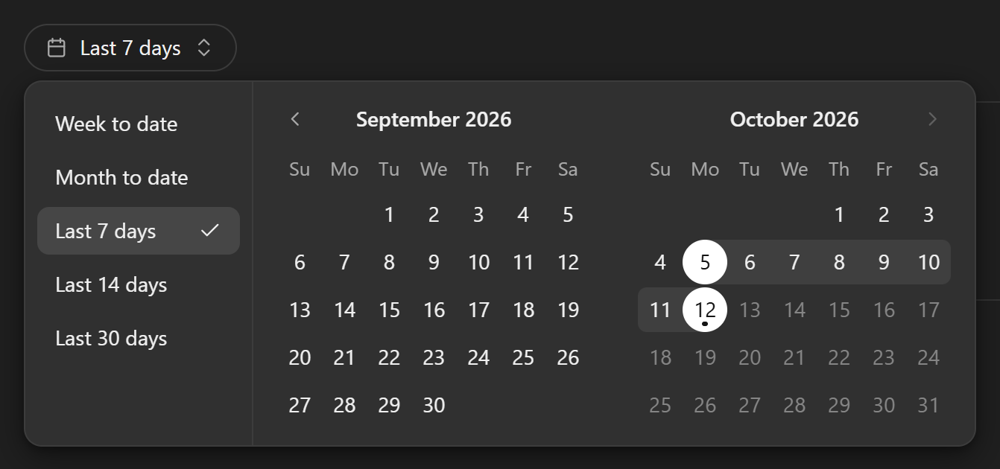
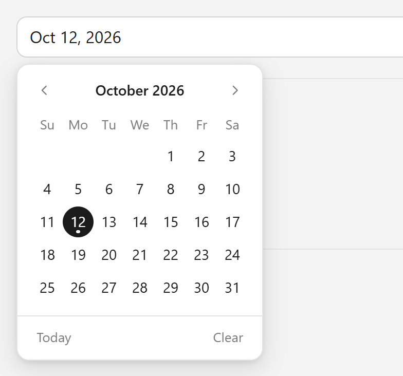
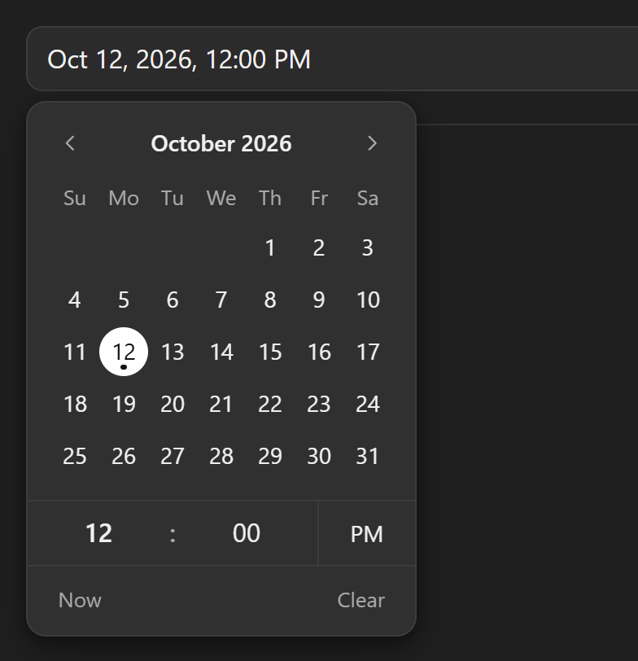

# flow-datepicker

A light, keyboard-first date, time and date range picker for plain HTML forms. No dependencies.

It enhances a normal `<input type="date">`, `<input type="time">` or `<input type="datetime-local">`, and adds a date range picker with presets. The native input stays the source of truth, so forms post exactly what they posted before.

**Documentation with live demos: https://waqasahmaddev.github.io/flow-datepicker/**

<p>
  
</p>
<p>
  
  
</p>

## Features

- **Four modes, one library:** date, time, date and time, and a date range with presets. The mode comes from the input `type`.
- **Plain HTML first:** forms post ISO values (`2026-10-12`, `09:30`, `2026-10-12T09:30`). `min`, `max`, `step`, `required` and `disabled` are read from the native attributes. If the script does not load, the browser's own picker still works.
- **Keyboard first:** arrow keys in the calendar, Page Up and Page Down for months, a time row you can step or type into, and Escape always closes.
- **Type or pick:** dates and times can be typed in the order of the page language (`10/12/2026`, `Oct 12`, `9:30 pm`).
- **Every language:** month and weekday names, week start, 12 or 24 hour clock come from `Intl`. No locale files.
- **Responsive:** the range picker shows two months, one month, or only the calendar, depending on the space.
- **Light and dark:** follows `color-scheme`, Bootstrap's `data-bs-theme` or a `.dark` class. Every colour and size is a CSS custom property.
- **htmx friendly:** swapped-in inputs start by themselves and every change fires the native `change` event.
- **Small:** about 14.7 KB gzipped JavaScript and 2.8 KB CSS for all four modes.

## Install

From a CDN:

```html
<link rel="stylesheet" href="https://cdn.jsdelivr.net/npm/flow-datepicker@1.0.0/dist/flow-datepicker.min.css">
<script src="https://cdn.jsdelivr.net/npm/flow-datepicker@1.0.0/dist/flow-datepicker.min.js"></script>
```

From npm:

```bash
npm install flow-datepicker
```

```js
import { FlowDatepicker } from 'flow-datepicker';
import 'flow-datepicker/css';

FlowDatepicker.init(document);
```

Or download the files from the [latest release](https://github.com/waqasahmaddev/flow-datepicker/releases/latest).

Loading the script build in the `<head>` (without `defer`) lets it enhance inputs while the page is parsed, so nothing moves on screen.

## Usage

```html
<input type="date" name="publishDate" data-flow-datepicker>
<input type="time" name="startTime" step="300" data-flow-datepicker>
<input type="datetime-local" name="meetingAt" data-flow-datepicker>

<div data-flow-datepicker="range" data-fdp-max="today">
  <input type="date" name="from">
  <input type="date" name="to">
</div>
```

Every element with `data-flow-datepicker` starts by itself.

## Options

All options work as `data-fdp-*` attributes or as JS options in `new FlowDatepicker(element, options)`.

| Attribute | Meaning | Default |
|---|---|---|
| `data-fdp-min`, `data-fdp-max` | `today` or an ISO date, written to the native `min` / `max` | none |
| `data-fdp-close-on-select` | `false` keeps the calendar open after a pick | `true` |
| `data-fdp-presets` | JSON list of presets, or `none` | week and month to date, last 7, 14 and 30 days |
| `data-fdp-calendar` | `custom` shows only the presets plus "Custom range", which opens the calendar | `always` |
| `data-fdp-trigger` | `field` or `pill` | `pill` for range, `field` otherwise |
| `data-fdp-months` | months shown in range mode | fits the space (2 or 1) |
| `data-fdp-week-start` | first day of the week, `0` (Sunday) to `6` | from the locale |
| `data-fdp-hour-cycle` | `12` or `24` | from the locale |
| `data-fdp-locale` | language tag such as `de-DE` | nearest `lang`, then the browser |
| `data-fdp-placeholder` | placeholder text | a hint such as `mm/dd/yyyy` |

The native `step` attribute sets the minute step of the time handles (`step="300"` is 5 minutes).

A preset is `{ "label": "Last 90 days", "days": 90 }`, `{ "label": "Year to date", "period": "year" }` or `{ "label": "Q3", "from": "2026-07-01", "to": "2026-09-30" }`. "Last N days" means today minus N days through today, the same as MUI X and Ant Design.

See the [options reference](https://waqasahmaddev.github.io/flow-datepicker/reference/options) for everything.

## API

```js
const picker = FlowDatepicker.get('#publishDate');
picker.getValue();               // '2026-10-12'
picker.setValue('2026-11-03');
picker.open();
picker.close();
picker.clear();
picker.setOptions({ closeOnSelect: false });
picker.destroy();

FlowDatepicker.get(rangeWrapper).getValue(); // { from: '2026-10-05', to: '2026-10-12', preset: 'last-7-days' }
```

Every change fires the native `input` and `change` events on the inputs. The picker also fires `fdp:open` and `fdp:close`. See the [API reference](https://waqasahmaddev.github.io/flow-datepicker/reference/api).

## Browser support

| Browser | Version | Status |
|---|---|---|
| Chrome, Edge | 123 and newer | supported, fully tested |
| Firefox | 125 and newer | supported, fully tested |
| Safari (macOS, iOS) | 17.5 and newer | works, basic tests only |

## Development

```bash
npm install
npm run build
npm run serve
```

The demo runs at http://localhost:5280/demo/. The docs run with `npm run docs:dev` at http://localhost:5290/. See [CONTRIBUTING.md](CONTRIBUTING.md) and [CHANGELOG.md](CHANGELOG.md).

## License

[MIT](LICENSE)
